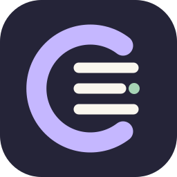

# Chromatic

A Windows launcher for Chromium-based browser profiles, built with Electron, TypeScript, and React.



## Install

Download **Chromatic.Setup.0.2.0.exe** from the [private release page](https://github.com/imlokesh/chromatic/releases/tag/v0.2.0). Sign in with an account that has repository access. The per-user installer registers `.chromatic` references and their **Open** and **Edit profile** Explorer actions. On Windows 11, Edit profile may be under **Show more options**.

The build is unsigned; Windows may show an unknown publisher. Install new releases over the existing version. There is no automatic updater. Uninstalling preserves browser data and app settings.

## Everyday use

- **Ctrl+Alt+Space** opens the quick launcher. Search names, labels, or browsers; use arrows and Enter. Hidden profiles never appear here.
- Create an isolated profile or use **Find existing**. Manual Chromium folders use the **User Data root** plus a subfolder such as `Default` or `Profile 1`.
- A supported system-default browser is preferred; otherwise the first detected Chromium browser is preselected. Chrome, Edge, Brave, and Chromium are detected at standard Windows locations. Add custom Chromium executables in **Browsers**.
- Use multiple **labels**, filter by label, or group the manager by label. Profiles can appear in multiple groups; bulk actions count them once.
- **Duplicate** copies settings into a fresh, empty browser profile. **Fork** copies settings and persistent browser data to an independent folder, excluding disposable caches. Both let you name the result. Hidden profiles remain hidden; favorites and recent-use history reset.
- Fork requires the source browser closed, including background processes. It copies the selected profile and `Local State` encryption metadata, not sibling profile directories. Some browser-bound credentials or website sessions may require signing in again. Local extension folder references remain references.
- **Storage** measures profile sizes and disposable cache without changing files. Total profile size includes cache. Root-level shared files are counted once; shared subdirectories are excluded. Partial scans are identified. Sizes can change while browsers run.
- **Review cleanup** opens the cache preview. Close the relevant browser and explicitly confirm deletion. There is no automatic cleanup.
- Action menus also offer edit, favorite, hide, export, and slim. Exported `.chromatic` files contain a stable local ID, not browser data or credentials.

## Proxies

The editor supports HTTP/HTTPS proxies with Basic authentication and SOCKS5 with optional username/password. Passwords are protected for the current Windows account using Electron `safeStorage` and omitted from snapshots, exports, browser arguments, and logs. Leaving a saved password field blank keeps it; use **Remove saved password** to clear it.

Chromatic runs a loopback forwarding service for configured proxies. Keep it running in the tray while using proxied profiles. Quitting stops these connections; the app asks before doing so. Browser restart is required after settings change or interrupted forwarding. Profiles inside one shared User Data root cannot use conflicting proxy/launch settings in the same running instance; Duplicate creates an isolated alternative.

**Test proxy** requests `https://api.ipify.org?format=json` through the same forwarding implementation and displays public IP, elapsed request time, and timestamp. Tests are manual, cancellable, and time out after 15 seconds. Failed upstream connections do not fall back to direct forwarding. TLS verification stays enabled; SOCKS5 destination hostnames are resolved upstream.

This is a browser web proxy, not a system VPN. It does not promise to route every browser protocol or other applications' traffic. The loopback service is available to local processes while active. NTLM/Kerberos, PAC rules, and custom bypass lists are not included.

## Data and privacy

Settings live at `%LOCALAPPDATA%\Chromatic\settings.json`; managed profiles normally live under `%LOCALAPPDATA%\Chromatic\Profiles\<UUID>`. Existing profiles stay in place. Removing a registration never deletes browser data.

Upgrading from 0.1 preserves `settings.v1.backup.json`, migrates tags to labels, and archives Firefox registrations in `archived-firefox.json`. Firefox is no longer supported; its browser data is untouched. Unsupported old proxy strings are kept for review rather than silently changing routing.

Slimming only removes verified Chromium disk/code/GPU caches. Cookies, credentials, keys, sessions, bookmarks, history, extensions, preferences, local storage, IndexedDB, service workers, and offline site storage are preserved. Cleanup skips linked, changed, locked, or uncertain files. All processes matching the browser executable name must be closed. Caches rebuild; slimming does not guarantee better browsing speed or indefinite website sessions.

The PIN gates access **inside Chromatic**. Hidden profiles require unlocking for launch, editing, exporting, copying, labels, and storage operations. Locking cancels unfinished private operations and clears private UI state. The PIN does not encrypt browser data or prevent direct filesystem access by the same Windows user. There is no PIN recovery.

## Development and verification

Windows x64, Node.js 22+, npm, and Git are required.

```text
npm ci
npm test
npm run build
node scripts/smoke.cjs
node scripts/features-smoke.cjs
node scripts/fork-browser-smoke.cjs
node scripts/proxy-live-smoke.cjs
npm run package
```

Electron/browser tests use disposable profiles, never real user data. The live proxy test contacts ipify through a local authenticated fixture; other proxy tests use local servers. `tests/localhost-{cert,key}.pem` are public self-signed localhost test fixtures, not production credentials. Screenshots go in ignored `artifacts/`. Set `CHROMATIC_SMOKE_EXE` to an installed executable to test that package with the Electron smoke scripts.

`npm run dev:app` builds and launches Electron; `npm run dev` serves only the renderer. Installers go under `release/`. Windows CI runs unit tests, builds, exercises both Electron smoke scripts, and packages installer artifacts.

`electron/` owns validated IPC, persistence, Windows integration, copy/cleanup safety, proxy services, and diagnostics. `shared/` defines serializable interfaces and search. `src/` is a sandboxed React renderer with no Node access. New operations are cancellable and use profile IDs across IPC.

Releases contain the installer, blockmap, and SHA256 checksums. Signing, automatic updates, userscripts, managed browser downloads, cloud sync, workspaces, and backup/restore are not included. The SVG icon is original project artwork.
